# Assistant Bounded Context Class Diagrams

This document contains the unified class diagram of the Assistant bounded context: the AI assistant
that answers questions about the user's own air quality data through DeepSeek.

## Unified Class Diagram

```mermaid
---
title: DDD Class Diagram - Assistant Bounded Context (4 Layers)
---

classDiagram

namespace interfaces {
    class AssistantController {
        +sendMessage(userId, SendAssistantMessageRequest) ResponseEntity
        +getConversations(userId, page, size) ResponseEntity
        +getConversationMessages(userId, conversationId) ResponseEntity
        +getUsage(userId) ResponseEntity
        +rateMessage(userId, messageId, RateAssistantMessageRequest) ResponseEntity
    }
    class AssistantExceptionHandler {
        +handleQuotaExceeded(AssistantQuotaExceededException) ResponseEntity
        +handleUnavailable(AssistantUnavailableException) ResponseEntity
    }
    class SendAssistantMessageRequest {
        +UUID conversationId
        +String content
        +String locale
    }
    class AssistantReplyResource {
        +UUID conversationId
        +ConversationMessageResource userMessage
        +ConversationMessageResource assistantMessage
        +AssistantUsageResource usage
    }
    class AssistantUsageResource {
        +int used
        +int limit
        +int remaining
        +Instant resetsAt
        +String plan
    }
}

namespace application {
    class AssistantCommandServiceImpl {
        -ConversationRepository conversationRepository
        -ConversationMessageRepository conversationMessageRepository
        -AssistantUsageCalculator assistantUsageCalculator
        -AssistantContextAssembler assistantContextAssembler
        -LanguageModelClient languageModelClient
        +handle(SendAssistantMessageCommand) AssistantReply
        +handle(RateAssistantMessageCommand) void
    }
    class AssistantQueryServiceImpl {
        +handle(GetConversationMessagesQuery) List~ConversationMessage~
        +handle(GetConversationsByUserQuery) PageResult~Conversation~
        +handle(GetAssistantUsageQuery) DailyUsage
    }
    class AssistantUsageCalculator {
        -ZoneId zone
        +currentUsage(userId) DailyUsage
    }
    class AssistantContextAssembler {
        -int maxContextDevices
        +buildSystemPrompt(userId, locale, now) String
    }
    class LanguageModelClient {
        <<interface>>
        +complete(List~LanguageModelMessage~) LanguageModelReply
    }
    class ExternalBillingService {
        +getAssistantDailyMessageLimit(userId) int
        +getPlanName(userId) String
    }
    class ExternalDeviceService {
        +findDeviceIdsByOwnerId(userId) List~UUID~
        +findVisibleSinceByDeviceId(deviceId) Optional~Instant~
        +findEnabledThresholdsByDeviceId(deviceId) List~ThresholdSummary~
    }
    class ExternalEvaluationService {
        +findLatestReading(deviceId, visibleSince) Optional~TelemetryReading~
    }
    class ExternalAlertingService {
        +findActiveAlertsByOwnerId(userId, limit) List~AlertDetails~
    }
}

namespace domain {
    class Conversation {
        -UUID id
        -UUID userId
        -String title
        -Instant lastMessageAt
        -int messageCount
        +start(userId, firstMessage, startedAt)$ Conversation
        +recordExchange(at) int
        +belongsTo(userId) boolean
    }
    class ConversationMessage {
        -UUID id
        -UUID conversationId
        -UUID userId
        -int position
        -MessageRole role
        -String content
        -String model
        -Integer promptTokens
        -Integer completionTokens
        -Integer latencyMs
        -FeedbackRating feedback
        +user(conversationId, userId, position, content)$ ConversationMessage
        +assistant(conversationId, userId, position, content, model, tokens, latency)$ ConversationMessage
        +rate(FeedbackRating) void
    }
    class DailyUsage {
        +String plan
        +int used
        +int limit
        +Instant resetsAt
        +remaining() int
        +isExhausted() boolean
    }
    class MessageRole {
        <<enumeration>>
        USER
        ASSISTANT
    }
    class FeedbackRating {
        <<enumeration>>
        UP
        DOWN
    }
    class AssistantLocale {
        <<enumeration>>
        ES
        EN
    }
    class ConversationRepository {
        <<interface>>
        +save(conversation) Conversation
        +findByIdAndUserId(conversationId, userId) Optional~Conversation~
        +findByUserId(userId, page, size) PageResult~Conversation~
    }
    class ConversationMessageRepository {
        <<interface>>
        +saveAll(messages) List~ConversationMessage~
        +findRecentByConversationId(conversationId, limit) List~ConversationMessage~
        +countByUserIdAndRoleSince(userId, role, since) long
    }
    class AssistantQuotaExceededException
    class AssistantUnavailableException
}

namespace infrastructure {
    class DeepSeekLanguageModelClient {
        -RestTemplate restTemplate
        -String apiUrl
        -String model
        +complete(List~LanguageModelMessage~) LanguageModelReply
    }
    class ConversationRepositoryImpl
    class ConversationMessageRepositoryImpl
    class ConversationPersistenceEntity
    class ConversationMessagePersistenceEntity
}

AssistantController --> AssistantCommandServiceImpl
AssistantController --> AssistantQueryServiceImpl
AssistantCommandServiceImpl --> AssistantUsageCalculator
AssistantCommandServiceImpl --> AssistantContextAssembler
AssistantCommandServiceImpl --> LanguageModelClient
AssistantCommandServiceImpl --> ConversationRepository
AssistantCommandServiceImpl --> ConversationMessageRepository
AssistantQueryServiceImpl --> AssistantUsageCalculator
AssistantUsageCalculator --> ExternalBillingService
AssistantContextAssembler --> ExternalDeviceService
AssistantContextAssembler --> ExternalEvaluationService
AssistantContextAssembler --> ExternalAlertingService
Conversation "1" o-- "*" ConversationMessage
ConversationMessage --> MessageRole
ConversationMessage --> FeedbackRating
DeepSeekLanguageModelClient ..|> LanguageModelClient
ConversationRepositoryImpl ..|> ConversationRepository
ConversationMessageRepositoryImpl ..|> ConversationMessageRepository
ConversationRepositoryImpl --> ConversationPersistenceEntity
ConversationMessageRepositoryImpl --> ConversationMessagePersistenceEntity
```

## Design Notes

- **Quota before the model.** `AssistantCommandServiceImpl` checks `DailyUsage` first and throws
  `AssistantQuotaExceededException` (HTTP 429) without calling DeepSeek. The daily allowance comes
  from the user's effective plan through the Billing ACL: FREEMIUM 10, PREMIUM 100. The day is the
  calendar day in `assistant.time-zone` (America/Lima by default).
- **Nothing stored on failure.** The model call runs outside any transaction. Only after it answers
  are the conversation and both turns written in one transaction, so a failed call
  (`AssistantUnavailableException`, HTTP 503) consumes no quota.
- **Order by position.** A question and its answer share a transaction and can share `created_at`;
  `Conversation.recordExchange` hands out positions and a unique index on
  `(conversation_id, position)` keeps the order deterministic.
- **Privacy.** `AssistantContextAssembler` sends only names, measurements, thresholds and alert facts.
  The email and every identifier stay on the server, user-typed names are flattened to one short
  line, and readings older than the device's `visibleSince` are never included.
- **DeepSeek.** `deepseek-flash` with `"thinking": {"type": "disabled"}`; with reasoning on, the
  model can spend the token budget thinking and return an empty answer. A `deepseek` circuit breaker
  wraps the call. The API key lives only in the `DEEPSEEK_API_KEY` environment variable and is never
  logged.
